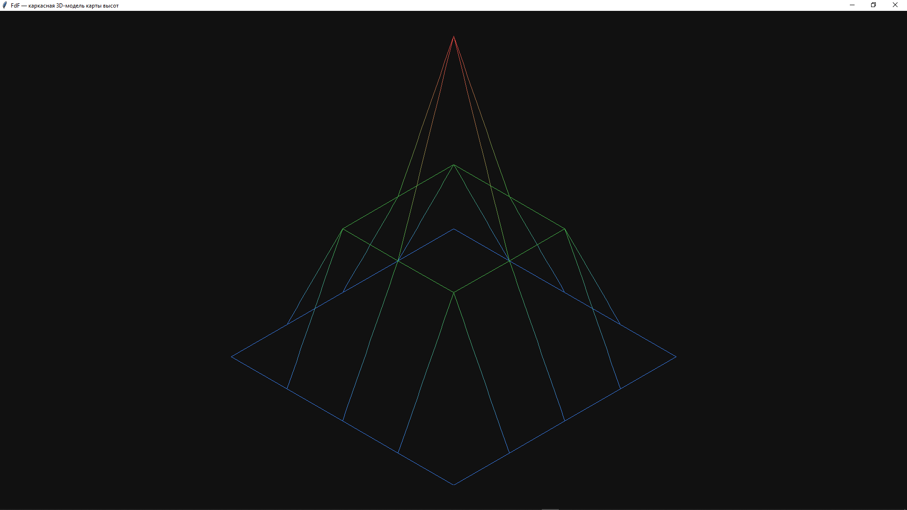

# FdF — каркасная 3D-модель карты высот



## Описание
Приложение для построения и визуализации каркасной (wireframe) 3D-модели поверхности по карте высот в формате `.fdf` с использованием изометрической проекции.

## Установка и запуск
```bash
python -m venv .venv
# Активация в Windows (PowerShell):
.\.venv\Scripts\Activate.ps1
# Установка инструментов разработки:
pip install pytest mypy ruff

# Запуск программы:
python main.py maps/elem.fdf
```
Управление

**Сдвиг карты:** стрелки (`←`, `↑`, `↓`, `→`)
**Масштаб:** колёсико мыши
**Высота рельефа:** `+` / `-`
**Переключение вида (изометрия / вид сверху):** `t`
**Поворот карты:** `q` / `e`
**Выход:** `Esc`

Формат карты
Файл .fdf представляет собой текстовую сетку целых чисел (высот z), разделённых пробелами. Каждая строка соответствует координате y, позиция в строке — координате x. К высоте через запятую может добавляться цвет в шестнадцатеричном формате 0xRRGGBB:

0 0 0 0 0
<br>
0 2 2 2 0
<br>
0 2 5 2 0
<br>
0 2 2 2 0
<br>
0 0 0 0 0

Структура проекта
main.py — точка входа, разбор аргументов командной строки и обработка ошибок запуска.
fdf/parser.py — чтение и валидация .fdf-файлов, генерация MapFormatError.
fdf/model.py — модели данных Point и Map.
fdf/projection.py — изометрическая проекция, масштабирование и центрирование (Camera).
fdf/app.py — графический интерфейс и отрисовка каркаса.
tests/ — модульные тесты на pytest.

Тесты
```
Bash
pytest -q
mypy --strict fdf main.py
ruff check .
```

Лицензия
MIT
